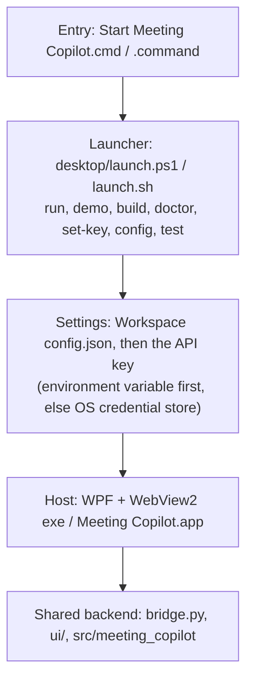

# Opening Meeting Copilot with one click

No environment variables are needed. From the `Testing Field` folder:

| Platform | Double-click | Same thing from a terminal |
|---|---|---|
| Windows | `Start Meeting Copilot.cmd` | `desktop\launch.cmd run` |
| macOS | `Start Meeting Copilot.command` | `./desktop/launch.sh run` |

The first launch builds the app, which copies the Python environment and can
take a few minutes. Later launches open the existing build, and rebuild it
automatically when the backend, shared UI, platform host or installed packages
have changed.

## Layers

The launchers only decide *whether to build* and *what to open*. They call the
existing `build-windows.ps1` and `build-macos.sh`, and the hosts and
`bridge.py` protocol are unchanged.

## Commands

Use `desktop\launch.cmd <command>` on Windows and `./desktop/launch.sh <command>` on macOS.

| Command | What it does |
|---|---|
| `run` | Opens the app. Builds first when there is no build or the source changed. This is the default. |
| `demo` | Opens the app on a separate `Demo Workspace` with no configuration and no API key, so the sample meeting always loads. |
| `build` | Builds or rebuilds the app (`build\windows` on Windows, `build/desktop` on macOS). Close the app first. |
| `doctor` | Checks the Python environment and packages, build tools, runtimes, the build, the configuration and the API key, and prints a fix for anything missing. |
| `set-key` | Saves the provider API key in Windows Credential Manager or the macOS Keychain from a hidden prompt. |
| `config` | Creates `config.json` in the Workspace from `config.example.json` if there is none, and opens it. |
| `test` | Runs the Python tests and the shared desktop UI tests. |
| `help` | Lists the commands. |

## One-time setup

1. Create the Python environment with the audio and desktop extras:
   `python -m venv .venv`, then install `-e '.[audio,desktop]'` into it. The
   `desktop` extra adds `keyring`, which is only needed for `set-key`.
2. Install the build tool for your platform. Windows needs the .NET 8 SDK
   (`winget install Microsoft.DotNet.SDK.8`); opening an existing build only
   needs the .NET 8 Desktop Runtime and WebView2. macOS needs the Xcode Command
   Line Tools (`xcode-select --install`).
3. Run `doctor` and fix anything it reports as missing.

## Using a real model

The app answers from local excerpts until a provider is configured.

1. Run `config` and set `provider`, `model`, `base_url` if needed, and
   `send_evidence` in the Workspace `config.json`. Leave `api_key_env` as a
   name; never put the key itself in the file.
2. Open **Settings** in the app and paste the key, or run `set-key` and paste
   it at the hidden prompt. Either way it is stored in the system credential
   store under the service name `Meeting Copilot` and the name in
   `api_key_env`.
3. Reopen the app.

Key lookup order: the environment variable named by `api_key_env` wins, then
the saved key. Set `MEETING_COPILOT_KEYRING=0` to ignore the saved key; the
test suite sets this so it can never use a real key. The saved key is used
wherever the provider is called, so CLI commands such as `ask` and the
explicitly paid `evaluate --api` can use it too. The grounding benchmark still
checks the environment variable itself and is unchanged.
Remove a saved key with
`python -m meeting_copilot.credentials delete` (add `--config <path>` or
`--name <name>` to match what you saved).

## Optional overrides

`MEETING_COPILOT_DESKTOP_DATA_DIR` and `MEETING_COPILOT_DESKTOP_CONFIG` still
select a different workspace or configuration, and `MEETING_COPILOT_PYTHON`
(Windows) still selects the Python environment to build from. The Windows
launcher clears `MEETING_COPILOT_DESKTOP_ROOT` and `MEETING_COPILOT_PYTHON` for
the app it starts, so the bundle always runs its own copied backend.

## Validation status

Recorded 2026-11-27 on Windows 11 with the .NET SDK 8.0.428. Verified: the
credential tests, a real Windows Credential Manager round trip with a dummy
value, `doctor`, `help` and error reporting. `build` produced a real bundle
through `dotnet publish`; `demo` and `run` opened it with no Meeting Copilot
environment variables set, the window rendered the sample meeting, the Python
bridge started from the bundle's own runtime, and closing the window ended both
processes. Editing a source file made the next `run` rebuild and replace the
bundle. Not yet verified: a real-provider request using a saved key, and
everything in `launch.sh` and `Start Meeting Copilot.command` beyond a shell
syntax check, because no Mac was available.
