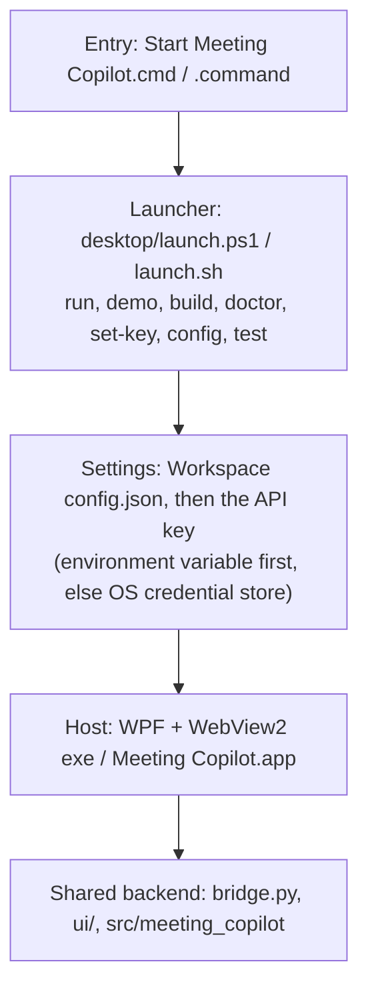

# Opening Meeting Copilot with one click

No environment variables are needed. From the `Testing Field` folder:

| Platform | Double-click | Same thing from a terminal |
|---|---|---|
| Windows | `Start Meeting Copilot.cmd` | `desktop\launch.cmd run` |
| macOS | `Start Meeting Copilot.command` | `./desktop/launch.sh run` |

The first launch builds the app, which copies the Python environment and can
take a few minutes. Later launches open the existing build, and rebuild it
automatically when the backend, shared UI, platform host or installed packages
have changed.

## Layers

The launchers only decide *whether to build* and *what to open*. They call the
existing `build-windows.ps1` and `build-macos.sh`, and the hosts and
`bridge.py` protocol are unchanged.

## Commands

Use `desktop\launch.cmd <command>` on Windows and `./desktop/launch.sh <command>` on macOS.

| Command | What it does |
|---|---|
| `run` | Opens the app. Builds first when there is no build or the source changed. This is the default. |
| `demo` | Opens the app on a separate `Demo Workspace` with no configuration and no API key, so the sample meeting always loads. |
| `build` | Builds or rebuilds the app (`build\windows` on Windows, `build/desktop` on macOS). Close the app first. |
| `package` | Windows only. Builds a portable zip for another PC; see below. |
| `doctor` | Checks the Python environment and packages, build tools, runtimes, the build, the configuration and the API key, and prints a fix for anything missing. |
| `set-key` | Optional. Saves the API key from a terminal; **Settings** in the app does the same. |
| `config` | Optional. Opens the Workspace `config.json`; **Settings** in the app writes the model choice there. |
| `test` | Runs the Python tests and the shared desktop UI tests. |
| `help` | Lists the commands. |

## One-time setup

1. Create the Python environment with the audio and desktop extras:
   `python -m venv .venv`, then install `-e '.[audio,desktop]'` into it. The
   `desktop` extra adds `keyring`, which is only needed for `set-key`.
2. Install the build tool for your platform. Windows needs the .NET 8 SDK
   (`winget install Microsoft.DotNet.SDK.8`); opening an existing build only
   needs the .NET 8 Desktop Runtime and WebView2. macOS needs the Xcode Command
   Line Tools (`xcode-select --install`).
3. Run `doctor` and fix anything it reports as missing.

## Using a real model

Everything is done once, in the app. Until then the app answers from local
excerpts and shows a hint under the question box.

1. Open **Settings** (sidebar, or the hint under the question box).
2. Choose a provider. DeepSeek fills in the model and address that were
   validated for this project; for another provider type its model name and,
   if it is not the provider's default, its base URL.
3. Paste the API key and tick the box that allows the excerpts a question needs
   to be sent to that provider. Model answers need that permission.
4. **Save**, then **Test connection** to send one request that contains no
   meeting content.

The choice is used from the next question, with no restart, and is still there
the next time the app opens. The model choice is written to `config.json` in
the Workspace (only the provider fields change; anything else in an existing
file is kept). The key goes to Windows Credential Manager or the macOS
Keychain under the service name `Meeting Copilot`, never into a file.

Once sharing is allowed, the sample meeting uses the model too; before that it
stays on local excerpts.

A saved key is stored for the host it is sent to (for example
`MEETING_COPILOT_API_KEY@api.deepseek.com`), so switching provider never sends
one provider's key to another; the new provider simply has no key until one is
entered. A key saved by an earlier build without a host is never read and is
removed the next time a key is saved or removed in Settings. `set-key` saves for
the provider in the Workspace `config.json`, so choose the provider first.

Key lookup order: the environment variable named by `api_key_env` wins, then
the saved key. The environment variable is not tied to a host: if you set it, it
is sent to whichever provider is configured. Set `MEETING_COPILOT_KEYRING=0` to ignore the saved key; the
test suite sets this so it can never use a real key. The saved key is used
wherever the provider is called, so CLI commands such as `ask` and the
explicitly paid `evaluate --api` can use it too. The grounding benchmark still
checks the environment variable itself and is unchanged.

## Portable package (Windows)

`desktop\launch.cmd package` builds `MeetingCopilot-windows-x64.zip` in a new
`build\portable-<time>` folder. Unzip it anywhere and double-click
`Start Meeting Copilot.cmd` inside; nothing is installed, and the target PC
needs no Python, .NET or source checkout. The package carries a copy of the
Python the project environment was created from, only the runtime dependencies
(no test tools), the backend, the shared UI and a self-contained .NET host.

Measured on 2026-11-27: 259 MB zipped, 704 MB unpacked. Most of the size is
the speech and model libraries. `package-windows.ps1 -FrameworkDependent`
leaves out .NET (about 130 MB unpacked) for PCs that already have the .NET 8
Desktop Runtime.

It still needs the Microsoft Edge WebView2 Runtime, which Windows 11 includes.
The speech model is not inside: the first recording or audio import downloads
it once. The build is unsigned, so Windows may warn about an unknown publisher
after a download. Meetings and the model choice stay in
`%LOCALAPPDATA%\Meeting Copilot\Workspace` and the key in Windows Credential
Manager, so replacing the folder with a newer package keeps the setup.
Packaging needs the .NET 8 SDK and `uv` on the build PC. There is no macOS
package yet; on a Mac use `./desktop/launch.sh run`.

## Optional overrides

`MEETING_COPILOT_DESKTOP_DATA_DIR` and `MEETING_COPILOT_DESKTOP_CONFIG` still
select a different workspace or configuration, and `MEETING_COPILOT_PYTHON`
(Windows) still selects the Python environment to build from. The Windows
launcher clears `MEETING_COPILOT_DESKTOP_ROOT` and `MEETING_COPILOT_PYTHON` for
the app it starts, so the bundle always runs its own copied backend.

## Validation status

Recorded 2026-11-27 on Windows 11 with the .NET SDK 8.0.428.

Verified in the real app, driven over the WebView2 DevTools protocol:

- `build`, `run` and `demo` with no Meeting Copilot environment variables; the
  window rendered the sample meeting and closing it ended the backend. Editing
  a source file made the next `run` rebuild and replace the bundle.
- Model setup entirely in **Settings** against the real DeepSeek endpoint:
  save, **Test connection**, a cited model answer on the sample meeting, and
  the setup still in place after closing and reopening the app.
- The portable package, moved to another folder and started with a stripped
  environment (no Python, .NET or `uv` on the path): it ran its own Python and
  answered a question through DeepSeek with the saved key.
- Saving and removing a dummy key in Windows Credential Manager from the app.

Not yet verified: the portable package on a PC that has never had Python or
.NET installed; the OpenAI and Anthropic presets (only DeepSeek was called);
and everything on macOS, where `launch.sh`, `Start Meeting Copilot.command`
and the one-line allowlist change in `main.swift` have not been run or
compiled because no Mac was available.
